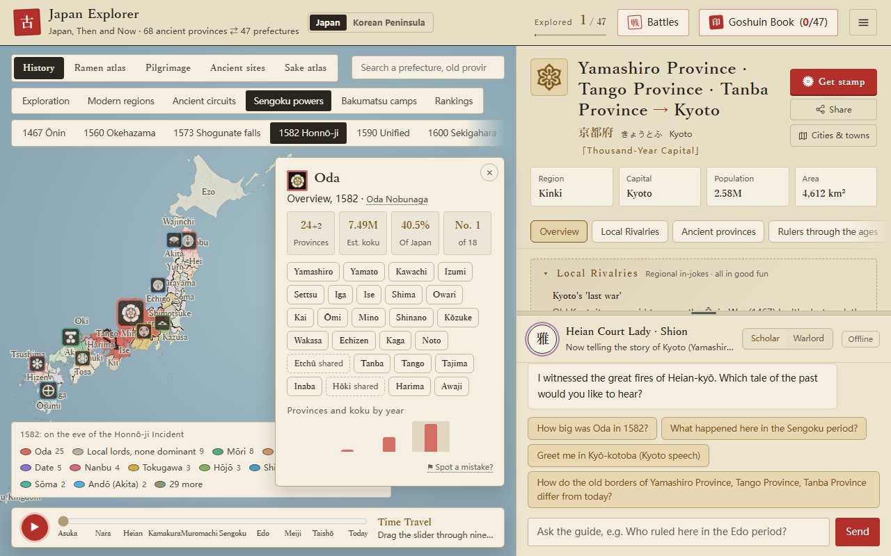
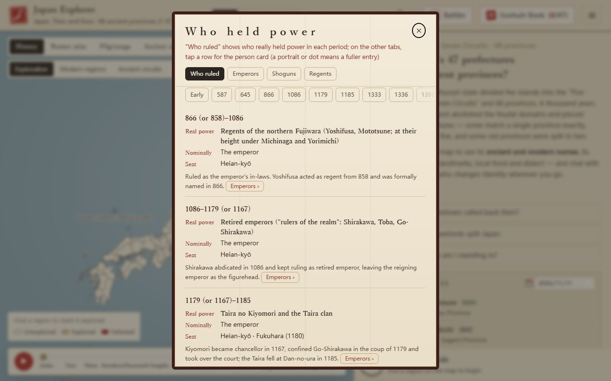
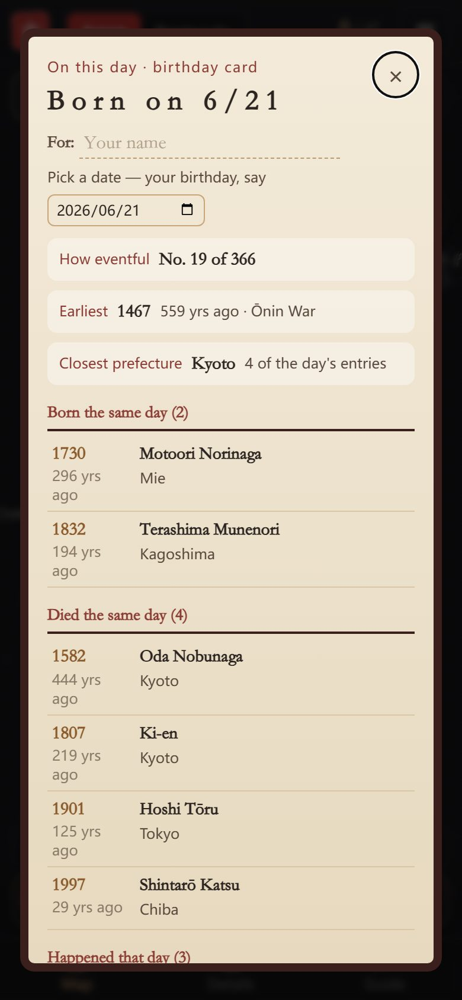
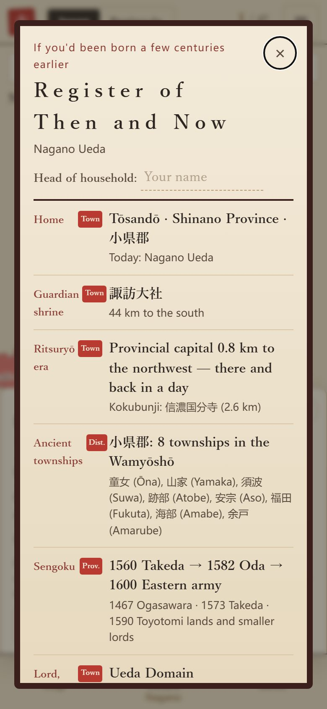

# Japan Explorer · Japan, Then and Now

[中文](README.md) | **English** | [日本語](README.ja.md)

[](https://github.com/Nickrockwall/japan-explorer/actions/workflows/checks.yml)

**▶ Open it: https://nickrockwall.github.io/japan-explorer/**


Old Japan laid over today's map. Which of the 68 ancient provinces became each of today's 47 prefectures? Who held them in the Sengoku period, which domain ruled them under the Edo shogunate, and what happened there on this day centuries ago? Tap a prefecture or a town, or use your phone's location, and see who ruled the ground under your feet in each era. You can also switch to the Korean Peninsula and compare Silla, Goryeo and Joseon with today.

<p>
  
  
</p>
<p>
  
  
</p>

## Try these first

- [Your birthday](https://nickrockwall.github.io/japan-explorer/#bday=06-21&lang=en): who was born and who died that day, and what happened (the link opens June 21, the day of the Honnō-ji Incident — change it to your own birthday in the dialog)
- [Japan in 1582](https://nickrockwall.github.io/japan-explorer/#pref=26&sg=1582&sgc=oda&lang=en): who held each of the 68 provinces just before Honnō-ji, and how much of Japan the Oda held
- [An ancestral register for Ueda, Nagano](https://nickrockwall.github.io/japan-explorer/#pref=20&muni=1&m=20203&koseki=1&lang=en): what your register would have said a few centuries ago; its closing timeline runs from Shinano Province to Nagano Prefecture
- [Who held power](https://nickrockwall.github.io/japan-explorer/#rl=power&lang=en): from the Yamato kingship to today, who was nominally in charge and who really ran things
- [The Korean Peninsula](https://nickrockwall.github.io/japan-explorer/#map=korea&lang=en): 29 regions, North and South, and the divisions of earlier kingdoms

## A few things you might not know

- Add up today's population by ancient province and **Musashi alone holds 21% of Japan** (about 25.9 million) — more than the 43 smallest provinces combined. All of **Oki** has about 19,000 people, not enough to fill half of Tokyo Dome.
- **Sado** has only 57% of the people it had in 1721, while **Kawachi** climbed from 43rd in the Edo census to 8th today.
- Of the 498 domains of the Edo period, 265 lasted until they were abolished in 1871; the **Takada Domain** in Echigo went through 9 ruling houses and 32 lords.
- In On this day, the busiest dates are **January 15, March 24 and May 15** (12 entries each; March 24 has the Sakuradamon Incident).
- After the domains were abolished, today's **Kagawa** was made, merged away and made again: Takamatsu → Kagawa → Myōdō → Kagawa → Ehime, and only in 1888 Kagawa for good.
- Ueda lies in Chiisagata District of Shinano Province; at the end of the Edo period, 106 of the district's 158 towns and villages belonged to the Ueda Domain.

Each of these is worked out from the app's own data, and you can open it to check.

## What's inside

**Maps**
- The real borders of the 68 ancient provinces under the 47 prefectures, colored by circuit; switch between 712, 757, 824 and 1869 to watch provinces split and merge
- Over 1,900 municipalities, colored by province or population, with their Meiji-era districts; search works with kanji, kana and English
- A time-travel slider through ten eras, from Asuka to today, with each era's powers and capital, and a banner naming who really held power

**History**
- A card for every prefecture: old and new names, six eras from the ritsuryō state to modern times, sights, food and dialect
- Sengoku map: who held each province in 1467, 1560, 1573, 1582, 1590 and 1600, with the leading figure of each; plus timelines (who really held power in each period, from the Yamato kingship to today; emperors, shoguns and regents) and bios and portraits for 61 people
- Battles: Okehazama, Kawanakajima, Sekigahara, Dan-no-ura and the Satsuma Rebellion, replayed in four phases and narrated by the generals themselves
- Edo domains: the lords of 498 domains by prefecture; a lord's birth and death dates sit next to the name and mark the place on the map
- Rankings: population today, Edo population, rice yield and the "300-year shake-up" for all 68 provinces, plus rival face-offs (Iga vs Kōka, Owari vs Mikawa…)
- All 69 prints of Hiroshige's *Famous Places in the Sixty-odd Provinces*, with where each scene is today; 190 things that still carry an old province name (the Shinano River, Sanuki udon, Iyokan…)

**About you**
- On this day: what happened in Japan on today's date centuries ago — events, and births and deaths of historical figures plus a few well-known modern people — with entries for every one of the 366 days, in a different order for everyone
- Birthday card: pick a date (your birthday, say) to see everything on it, how eventful it is among all 366 days and which prefecture it's most tied to; add a name and save it as an image
- Where am I?: find out which ancient province and district you're standing in
- Ancestral register: a "Register of Then and Now" with your guardian shrine, the distance to the provincial capital, the Sengoku-era holders, the late-Edo lords, your Boshin War side and a local greeting, ending with "This place through time" — who held the place from antiquity to today (the Edo domain and its houses, the prefectures it passed through after 1871; Okinawa, Hokkaidō and Amami follow their own histories), with events, births and deaths located there; each line says whether it's exact to the town, district, prefecture or province, and you can save it as an image
- Goshuin book: a stamp for every prefecture you visit; pay respects at each province's ichinomiya shrine online, and earn an "in person" stamp when you're actually there

**Just for fun**
- Ramen styles, local sake, 111 anime and taiga-drama locations, and regional in-jokes
- A guide who changes identity with the region (a Heian court lady, an ukiyo-e cat, a general…) and answers quick questions even without AI
- Japanese-style sound effects and koto background music, all synthesized in the browser

**Korean Peninsula** (the "Japan / Korean Peninsula" switch next to the title)
- 29 first-level regions, North and South (divisions as of 2026), with a drill-down to 400-plus cities and counties; names in English, Korean script and romanization
- Historical divisions: the Three Kingdoms, Silla's nine provinces, Goryeo's circuits, Joseon's eight provinces and the thirteen provinces of 1896; the Joseon layer marks the two towns each province is named after (Gyeongsang = Gyeongju + Sangju…)
- Household and farmland rankings from the 1432 geography of the Annals of King Sejong, six battlefields, and each region on Kim Jeong-ho's Daedongyeojido
- A peninsula seal book with 141 hyanggyo you can check in at, and each region's heritage-listed traditional liquor
- Nine episodes of shared history between Japan and the peninsula, set out as facts both sides accept, each side's mainstream account, and sources; disputed names such as Dokdo / Takeshima and Sea of Japan / East Sea appear side by side, with each side's position and no verdict

A tour runs on your first visit, and you can replay it from settings. The interface is in 中文, English and 日本語.

## How to use it

- **Phone**: open the link in your browser, in portrait or landscape. To add it to your home screen: Safari on iPhone → Share → "Add to Home Screen"; Chrome on Android → ⋮ → "Add to Home screen". Pages you've seen also work offline.
- **Computer**: the map is on the left, details and the guide on the right.
- **Sharing**: the Share button on a card copies a link with the region and language, e.g. `#pref=26&lang=ja` opens Kyoto in Japanese; birthday cards, ancestral registers and the Sengoku map have links of their own.
- **AI (optional)**: to chat freely with the guide, add your own key under "API Settings". Claude, Gemini and OpenAI-compatible services (including DeepSeek) are supported. The key stays in your browser, and requests go straight from your browser to the service you chose — never through this site.
- **Corrections**: every card ends with "Spot a mistake?", which opens a new GitHub issue already filled in with the card and the current link (needs a GitHub login).
- **Privacy**: no accounts and no analytics. Location is used only when you tap the button and is worked out on your device; your progress, stamps and name stay in your own browser.

## Where the data comes from

Everything has a source where possible, and the app says so where something is approximate:

- **Borders**: national map from 「地球地図日本」 (Geospatial Information Authority of Japan); municipal boundaries: 「国土数値情報（行政区域データ）」（国土交通省）を加工して作成. Province borders are pieced together from municipalities, and a municipality spanning two provinces counts toward the main one, so they are approximate.
- **Japanese Wikipedia** (CC BY-SA 4.0): Meiji-era districts; ichinomiya shrines, provincial capitals and kokubunji temples; Edo-period population and rice yield by province; each province's 1598 Taikō survey yield; late-Edo lords by district (旧高旧領取調帳); Edo domains and their lords; the towns and villages of the 1889 municipal system; where city names come from (our own summaries, checked against the articles — or against the city or prefecture's own website where Wikipedia is silent); provincial governors and daimyo of the Sengoku period; the date articles ("January 1"…). Each entry is checked by script — that coordinates fall inside the province, that a name really appears in the article — and anything that doesn't match is left out.
- **National Museum of Japanese History, Kyūdaka Kyūryō Torishirabechō database**: the late-Edo lord in the family register, worked out for each municipality by adding up the early-Meiji lords and rice yields of every village now inside it (only the totals are published, not the records).
- **CODH (Center for Open Data in the Humanities)** (CC BY 4.0): the 1920 / 1985 / 1995 municipal boundaries of its Historical Administrative Area Data Set, used to fill in Meiji villages Wikipedia doesn't list and to match old villages to today's municipalities; village coordinates from its Nihon Rekishi Chimei Taikei place-name data set.
- **Nara National Research Institute for Cultural Properties, ancient place-name search**: the townships (gō) of each district in the 10th-century Wamyō Ruijushō, with readings.
- **Wikidata** (CC0): municipal readings, populations and English names; reign years of lords that Wikipedia leaves out, from the "Lord of X Domain" position (failing that, from the daimyo table of the English Wikipedia domain article); dates, places and names in three languages for On this day — an event or person is kept only if the exact date matches Wikidata and the place falls inside a prefecture. Modern people are picked by a year (2025) of Japanese Wikipedia page views, two or three a day. Dates are Gregorian, and Julian before 1582, as on Wikipedia.
- **Korean Peninsula**: boundaries from geoBoundaries (South: Natural Earth, citypopulation.de; North: WFP / OCHA ROAP), names and populations from Wikidata, updated to the 2026 divisions using Korean Wikipedia. Historical divisions are pieced together from today's counties — Silla's nine provinces follow Korean Wikipedia's tables, Goryeo follows the Goryeosa geography treatise — and are approximate. Households and farmland for 1432 come from the original text of the Annals of King Sejong (National Institute of Korean History site). The Daedongyeojido is the Seoul National University Kyujanggak copy (public domain), with each region's area estimated by aligning the old map to today's coastline.
- **Images**: Hiroshige's prints, the 47 prefectural emblems and the Daedongyeojido are in the public domain; portraits are mostly public domain, two are CC BY-SA (credited on the card); the Sengoku crests come from each family's Japanese Wikipedia article and are public domain or CC BY / BY-SA (credited in the power overview). All from Wikimedia Commons.
- **Written for this site**: bios, histories, in-jokes, ramen and sake follow common accounts, with years and events checked against Wikipedia; some coloring shows only the dominant power in a prefecture or province and is approximate; uncertain points are marked "one account says". Meant for enjoyable browsing, not as an academic source.

## License

© 2026 Nickrockwall

- **Code**: [MIT](LICENSE)
- **Content** (historical text, personas and answers, translations, cover and icons): [CC BY-NC 4.0](https://creativecommons.org/licenses/by-nc/4.0/) — credit "Japan Explorer by Nickrockwall" with a link; no commercial use
- **Third-party material** follows its own terms; data from Wikipedia is CC BY-SA 4.0, not NC. Full list in [LICENSE-CONTENT.md](LICENSE-CONTENT.md)

What changed in each version: [CHANGELOG.en.md](CHANGELOG.en.md).

## Development

A static site: plain HTML / CSS / ES modules, with [Apache ECharts](https://echarts.apache.org/) bundled for the map (so it loads in mainland China too). No build step.

```bash
python -m http.server 8000          # run locally, then open http://localhost:8000 (double-clicking index.html won't work)
python tools/build_bundle.py        # rebuild after changing any JSON in src/data
python -X utf8 tools/check_data.py  # data checks
python -X utf8 tests/smoke.py       # UI tests (pip install playwright && python -m playwright install chromium)
```

Each push to GitHub runs the data checks and UI tests (desktop, tablet, phone portrait and landscape × zh / en / ja); the site is published to GitHub Pages only if everything passes. Data formats, the data tools in `tools/` and project conventions are documented in [CLAUDE.md](CLAUDE.md).
