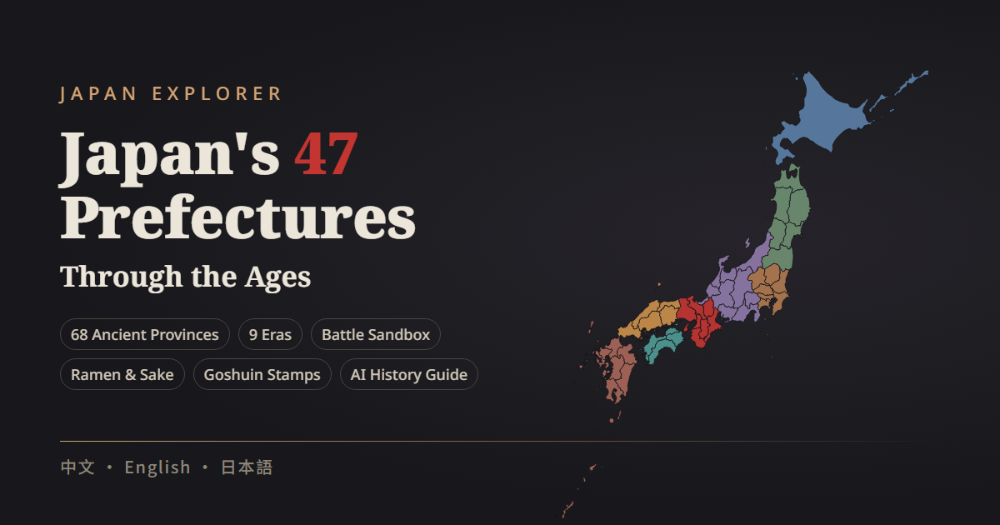
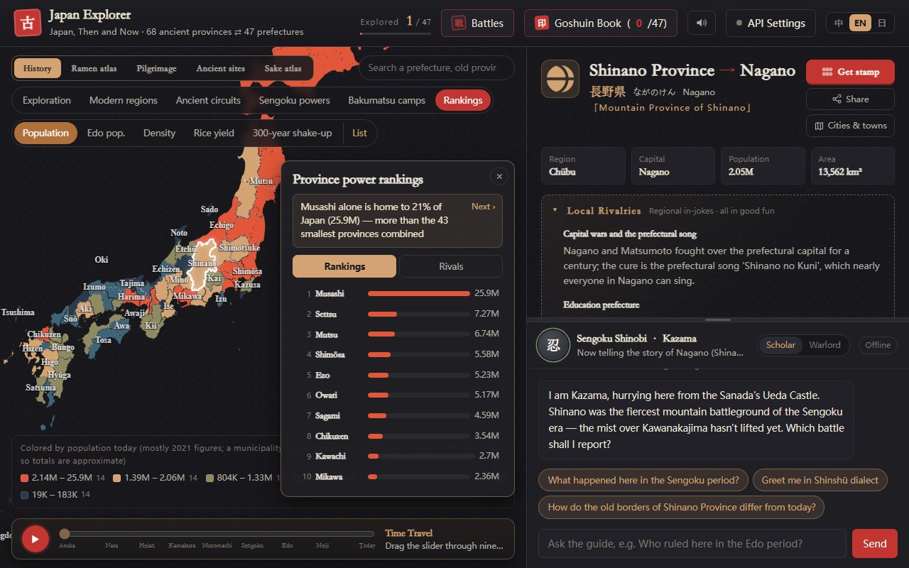
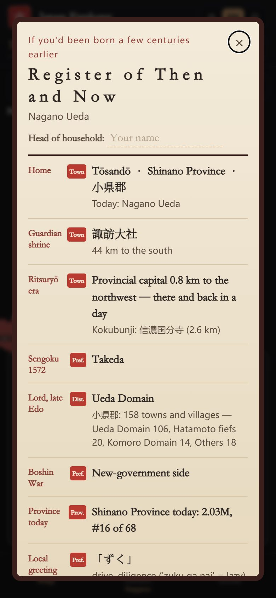

# Japan Explorer · Japan, Then and Now

[中文](README.md) | **English** | [日本語](README.ja.md)

[](https://github.com/Nickrockwall/japan-explorer/actions/workflows/checks.yml)

**▶ Open it: https://nickrockwall.github.io/japan-explorer/**



Old Japan laid over today's map: which of the 68 ancient provinces became each of today's 47 prefectures? Tap a prefecture or a town, or use your phone's location, and see who ruled the ground under your feet in each era.

<p>
  
  
</p>

## A few things you might not know

- Add up today's population by ancient province and **Musashi alone holds 21% of Japan** (about 25.9 million) — more than the 43 smallest provinces combined.
- All of **Oki** has about 19,000 people — not enough to fill half of Tokyo Dome.
- **Sado** has only 57% of the people it had in 1721, while **Kawachi** climbed from 43rd in the Edo census to 8th today.
- Ueda in Nagano lies in Chiisagata District of Shinano Province; at the end of the Edo period, 106 of the district's 158 towns and villages belonged to the Ueda Domain.

All of these come from the app's Rankings and Ancestral register views, and you can open each one to check.

## What you can do

**Explore the map**
- Then and now: the real borders of the 68 ancient provinces under the 47 prefectures, colored by circuit; switch between 712, 757, 824 and 1869 to watch provinces split and merge
- Over 1,900 municipalities, colored by province or population, with their Meiji-era districts; search works with kanji, kana and English
- Time travel: drag the slider through nine eras, from Asuka to today, with each era's powers and capital

**Read the history**
- A card for every prefecture: old and new names, six eras from the ritsuryō state to modern times, sights, food and dialect
- Battles: Okehazama, Kawanakajima, Sekigahara, Dan-no-ura and the Satsuma Rebellion, replayed in four phases and narrated by the generals
- On this day: what happened in Japan on today's date centuries ago (events, births and deaths of historical figures), in a different order for everyone — or look up your birthday
- Edo domains: the lords of 491 domains (270 lasting until 1871), listed by prefecture
- Sengoku map: who held each of the 68 provinces in six years — 1467 Ōnin, 1560 Okehazama, 1573, 1582 Honnō-ji, 1590 and 1600 Sekigahara — with the leading figure of each; plus an emperors and shoguns timeline and bios and portraits for 61 people
- Rankings: population today, Edo population, rice yield and the "300-year shake-up" for all 68 provinces, plus rival face-offs (Iga vs Kōka, Owari vs Mikawa…)
- All 69 prints of Hiroshige's *Famous Places in the Sixty-odd Provinces*, with where each scene is today; 190 things that still carry an old province name (the Shinano River, Sanuki udon, Iyokan…)

**About you**
- Where am I?: find out which ancient province and district you're standing in
- Ancestral register: a "Register of Then and Now" with your guardian shrine, the distance to the provincial capital, the Sengoku-era holders of your province, the late-Edo lords, your Boshin War side and a local greeting; each line says whether it's exact to the town, district, prefecture or province, and you can save it as an image
- Goshuin book: a stamp for every prefecture you visit; pay respects at each province's ichinomiya shrine online, and earn an "in person" stamp when you're actually there

**Just for fun**
- Ramen styles, local sake, 111 anime and taiga-drama locations, and regional in-jokes
- The time-travel guide changes identity with the region (a Heian court lady, an ukiyo-e cat, a general…) and answers quick questions even without AI
- Japanese-style sound effects and koto background music, all synthesized in the browser

A 9-step tour runs on your first visit, and you can replay it from settings. The interface is in 中文, English and 日本語.

## Korean Peninsula mode

The 'Japan / Korean Peninsula' switch next to the title opens the peninsula map (or open `#map=korea` directly):

- 29 first-level regions, North and South (divisions as of 2026), each with its name in English, Korean script and romanization, history across six eras, sights, food and dialect, and a drill-down to 400-plus cities and counties
- Historical divisions: Silla's nine provinces, Goryeo's circuits, Joseon's eight provinces and the thirteen provinces of 1896; the Joseon layer marks the towns each province is named after (Gyeongsang = Gyeongju + Sangju…)
- Where am I / Then and now: what your spot belonged to under Silla, Goryeo, Joseon and in 1896
- A peninsula seal book: one hangul square seal for each of the 29 regions, plus 141 hyanggyo (old county Confucian schools) you can check in at within 1 km
- Each region's traditional liquor (only those on heritage or Food Master registers) and how it looks on Kim Jeong-ho's Daedongyeojido (1861)
- Shared history of Japan and the Korean Peninsula: nine episodes from ancient migrants to the abductions, set out as facts both sides accept, each side's mainstream account, and sources — the same text in both modes
- Disputed places show both names and list each side's position: Dokdo / Takeshima, Sea of Japan / East Sea; Japan mode now draws Takeshima and the Northern Territories the same way
- Dancheong colours and gayageum-style music; the guide, Dancheong, answers questions even without an AI key

## How to use it

- **Phone**: open the link in your browser, in portrait or landscape. To add it to your home screen: Safari on iPhone → Share → "Add to Home Screen"; Chrome on Android → ⋮ → "Add to Home screen". Pages you've seen also work offline.
- **Computer**: open the link. The map is on the left, details and the guide on the right.
- **Sharing**: the Share button on a card copies a link with the region and language, e.g. `#pref=26&lang=ja` opens Kyoto in Japanese.

**AI (optional)**: to chat freely with the guide, add your own key under "API Settings". Claude, Gemini and OpenAI-compatible services (including DeepSeek) are supported. The key stays in your browser, and requests go straight from your browser to the service you chose — never through this site.

**Privacy**: no accounts and no analytics. Location is used only when you tap the button and is worked out on your device; your progress, stamps and household name stay in your own browser.

## Where the data comes from

Everything on the map has a source where possible, and the app says so where something is approximate:

- **Borders**: national map from 「地球地図日本」 (Geospatial Information Authority of Japan); municipal boundaries: 「国土数値情報（行政区域データ）」（国土交通省）を加工して作成. Province borders are pieced together from municipalities, and a municipality spanning two provinces counts toward the main one, so they are approximate.
- **From Japanese Wikipedia** (CC BY-SA 4.0): Meiji-era districts; ichinomiya shrines, provincial capitals and kokubunji temples; Edo-period population and rice yield by province; late-Edo lords by district (旧高旧領取調帳). Each entry is checked by script — for example, that its coordinates fall inside its province — and anything that doesn't match is left out.
- **Wikidata** (CC0): municipal readings, populations and English names; English names of domains.
- **Korean Peninsula**: boundaries from geoBoundaries (South: Natural Earth, citypopulation.de; North: WFP / OCHA ROAP), names and populations from Wikidata, updated to the 2026 divisions using Korean Wikipedia (e.g. Jeonnam-Gwangju, Incheon's new districts). Historical divisions are pieced together from today's counties; Silla's nine provinces follow the present-day locations in the Korean Wikipedia's nine-province tables, Goryeo's circuits follow the Goryeosa geography treatise, and the Three Kingdoms layer (c. 500) is inferred from the origins of Silla's provinces — all approximate. Households and farmland for 1432 come from the original text of the Annals of King Sejong (National Institute of Korean History site); battle texts are checked against the Korean, English and Japanese Wikipedia. Hyanggyo locations come from Wikidata (none verifiable yet in the North); liquors from Korean Wikipedia's intangible-heritage and Food Master lists; the Daedongyeojido is the Seoul National University Kyujanggak copy (public domain), with each region's area estimated by aligning the old map to today's coastline.
- **Ukiyo-e, emblems and portraits**: Hiroshige's prints and the 47 prefectural emblems are in the public domain; the portraits are mostly public domain, two are CC BY-SA (credited on the card). Images from Wikimedia Commons.
- **Sengoku map and people**: who held each province in each year, and the reign years of emperors, shoguns and regents, follow the shugo lists, list articles and biographies on Japanese Wikipedia, checked entry by entry by script; the bios are written for this site, with every year and event checked against the person's article. Where several powers shared a province only the main one is colored, so the map is approximate.
- History, in-jokes, ramen and sake follow common accounts, some coloring is approximate (e.g. by a prefecture's dominant power), and uncertain points are marked "one account says". Meant for enjoyable browsing, not as an academic source.

## License

© 2026 Nickrockwall

- **Code**: [MIT](LICENSE)
- **Content** (historical text, personas and answers, translations, cover and icons): [CC BY-NC 4.0](https://creativecommons.org/licenses/by-nc/4.0/) — credit "Japan Explorer by Nickrockwall" with a link; no commercial use
- **Third-party material** follows its own terms; data from Wikipedia is CC BY-SA 4.0, not NC. Full list in [LICENSE-CONTENT.md](LICENSE-CONTENT.md)

What changed in each version: [CHANGELOG.en.md](CHANGELOG.en.md).

## Development

A static site: plain HTML / CSS / ES modules, with [Apache ECharts](https://echarts.apache.org/) bundled for the map (so it loads in mainland China too). No build step.

```bash
python -m http.server 8000          # run locally, then open http://localhost:8000 (double-clicking index.html won't work)
python tools/build_bundle.py        # rebuild after changing any JSON in src/data
python -X utf8 tools/check_data.py  # data checks
python -X utf8 tests/smoke.py       # UI tests (pip install playwright && python -m playwright install chromium)
```

Each push to GitHub runs the data checks and UI tests (desktop, tablet, phone portrait and landscape × zh / en / ja); the site is published to GitHub Pages only if everything passes. Data formats, the data tools in `tools/` and project conventions are documented in [CLAUDE.md](CLAUDE.md).
