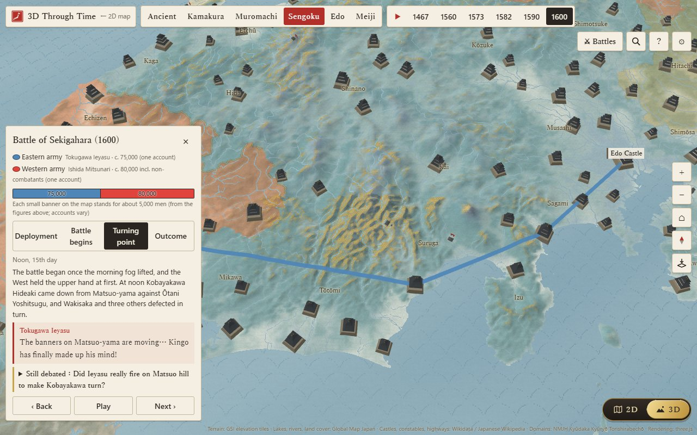

# Japan Explorer · Japan, Then and Now

[中文](README.md) | **English** | [日本語](README.ja.md)

[](https://github.com/Nickrockwall/japan-explorer/actions/workflows/checks.yml)

**▶ Open it: https://nickrockwall.github.io/japan-explorer/**


A web map that lays old Japan over today's. Which of the 68 ancient provinces became each of today's 47 prefectures? Who held them in the Sengoku period, which domain ruled them under the Edo shogunate, and which prefectures did they pass through after 1871? Tap a prefecture or a town, or use your phone's location, to see who ruled the ground under your feet in each era. No sign-up; the interface is in 中文, English and 日本語.

<p>
  
  
</p>
<p>
  
  
</p>
<p>
  
</p>

## Try these first

- [An ancestral register for Ueda, Nagano](https://nickrockwall.github.io/japan-explorer/#pref=20&muni=1&m=20203&koseki=1&lang=en): what your register would have said a few centuries ago; its closing timeline runs from Shinano Province to Nagano Prefecture
- [Japan in 1582](https://nickrockwall.github.io/japan-explorer/#pref=26&sg=1582&sgc=oda&lang=en): who held each of the 68 provinces just before Honnō-ji, and how much of Japan the Oda held
- [Who held power](https://nickrockwall.github.io/japan-explorer/#rl=power&lang=en): 20 periods from the Yamato kingship to today, each with its nominal head and who really ran things; the band at the top shows how long each lasted
- [Sekigahara in 3D](https://nickrockwall.github.io/japan-explorer/3d.html#bt=sekigahara&ph=2&lang=en): watch the Eastern and Western armies march across real terrain and Kobayakawa change sides
- [The constables of 1400](https://nickrockwall.github.io/japan-explorer/3d.html#y=1400&lang=en): the Muromachi period on the 3D map — which provinces the Hosokawa, Yamana, Uesugi and Ōuchi held
- [Your birthday](https://nickrockwall.github.io/japan-explorer/#bday=06-21&lang=en): who was born and who died that day, and what happened (the link opens June 21, the day of the Honnō-ji Incident; change it to your own)

## What you can explore

**The flat map**
- The borders of the 47 prefectures and 68 ancient provinces, colored by circuit; switch between 712, 757, 824 and 1869 to watch provinces split and merge, and drill down to over 1,900 municipalities
- A time-travel slider through ten eras, from Asuka to today, with each era's map and capital and a banner naming who really held power; click the era name to open that period in the timelines
- Sengoku map: who held each province in 1467, 1560, 1573, 1582, 1590 and 1600, with each family's crest banner, an overview of its lands and its leading figures (bios and portraits for 61 people)
- Timelines: who held power in each period, the 126 emperors, the shoguns and the Kamakura regents
- Battles: ten of them, from Ichi-no-Tani to the Satsuma Rebellion, replayed in four phases and narrated by the generals, with the size of each army and what historians still debate
- The lords of all 498 Edo domains; rankings of the 68 provinces (population today and in the Edo period, rice yield); all 69 of Hiroshige's *Famous Places in the Sixty-odd Provinces*; 190 things that still carry an old province name
- A card for every prefecture: old and new names, six eras of history, sights, food, dialect, ramen, sake, and anime and taiga-drama locations

**The 3D map** (the "2D | 3D" switch on the right of the map)
- Six periods on real terrain: the ancient circuits and roads, the provincial constables of Kamakura and Muromachi, the Sengoku warlords, the Edo domains and five highways, and the Meiji prefectures and railways — in the colours of a folding screen
- Over 800 castles (the 100 Fine Castles and surviving keeps are marked); a castle's card shows who held the area over the years, and you can climb the keep to look around
- ▶ plays from 712 to 1888, flying to what happened between each pair of years (76 events); ten battles replayed on the land, with banners for each side's strength
- The capital's card names that year's emperor, shogun and who really held power, and can expand all 20 periods to jump between them
- A thousand years here: long-press (phone) or right-click (computer) anywhere, and the camera stays on that spot while it lists, from 712 to 1888, which province it was in and who held it

**About you**
- Ancestral register: your guardian shrine, the distance to the provincial capital, the ancient township, which side you were on in the Sengoku battles and at Sekigahara, the late-Edo lord (with rice yields for your own municipality), the Meiji village, the towns before the Heisei mergers, where the name comes from and famous people born there; each line says whether it's exact to the town, district, prefecture or province, and you can save it as an image
- On this day and the birthday card: what happened on a date centuries ago, for all 366 days; pick a date to see everything on it and save it as an image
- Where am I?: which ancient province and district you're standing in (worked out on your device)
- Goshuin book: a stamp for every prefecture, and an "in person" stamp at each province's ichinomiya shrine
- A guide who changes identity with the region (a Heian court lady, an ukiyo-e cat, a general…) and answers common questions even without AI

**Korean Peninsula** (the "Japan / Korean Peninsula" switch next to the title): 29 regions, North and South, with their historical divisions, household rankings from 1432, the Daedongyeojido, and nine episodes of shared history set out as facts both sides accept, each side's mainstream account, and sources.

## A few things you might not know

- Add up today's population by ancient province and **Musashi alone holds 21% of Japan** (about 25.9 million) — more than the 43 smallest provinces combined. All of **Oki** has about 19,000 people, not enough to fill half of Tokyo Dome.
- **Sado** has only 57% of the people it had in 1721, while **Kawachi** climbed from 43rd in the Edo census to 8th today.
- Of the 498 domains of the Edo period, 265 lasted until they were abolished in 1871; the **Takada Domain** in Echigo went through 9 ruling houses and 32 lords.
- After the domains were abolished, today's **Kagawa** was made, merged away and made again: Takamatsu → Kagawa → Myōdō → Kagawa → Ehime, and only in 1888 Kagawa for good.
- Shinano Province mostly sided with the East at Sekigahara, but **Sanada Masayuki** at Ueda Castle fought for the West — so Ueda's register follows its lord.

Each of these is worked out from the app's own data, and you can open it to check.

## How to use it

- **Phone**: open the link in your browser, in portrait or landscape. To add it to your home screen: Safari on iPhone → Share → "Add to Home Screen"; Chrome on Android → ⋮ → "Add to Home screen". Pages you've seen also work offline.
- **Computer**: the map is on the left, details and the guide on the right. Rows of buttons (timeline jumps, filters, legends) scroll sideways with the mouse wheel or by dragging.
- **Sharing**: the Share button on a card copies a link with the region and language, e.g. `#pref=26&lang=ja` opens Kyoto in Japanese; registers, birthday cards, the Sengoku map, the timelines and the 3D map's years and battles have links of their own.
- **AI (optional)**: to chat freely with the guide, add your own key under "API Settings". Claude, Gemini and OpenAI-compatible services (including DeepSeek and Qwen) are supported. The key stays in your browser, and requests go straight from your browser to the service you chose.
- **Corrections**: every card ends with "Spot a mistake?", which opens a new GitHub issue already filled in with the card and the current link.
- **Privacy**: no accounts and no analytics. Your progress, stamps and name stay in your own browser.

## Where the data comes from

Everything has a source where possible and is checked by script — that coordinates fall inside the province, that a name and year really appear in the article — and anything that doesn't match is left out. The app says so where something is approximate.

- **Borders**: national map from 「地球地図日本」 (Geospatial Information Authority of Japan); municipal boundaries: 「国土数値情報（行政区域データ）」（国土交通省）を加工して作成. Province borders are pieced together from municipalities, and a municipality spanning two provinces counts toward the main one, so they are approximate. 3D terrain from GSI elevation tiles.
- **Japanese Wikipedia** (CC BY-SA 4.0): old districts; ichinomiya, provincial capitals and kokubunji; Edo population and rice yield; late-Edo lords by district; Edo domains and their lords; Meiji villages; provincial constables and Sengoku daimyo; castle building dates; the date articles. Bios and the stories behind place names are written for this site and only checked against the articles for years and key words.
- **National Museum of Japanese History, Kyūdaka Kyūryō Torishirabechō database**: late-Edo lords and rice yields for each municipality (totals only).
- **CODH** (CC BY 4.0): municipal boundaries of 1920, 1985 and 1995, and village coordinates from the Nihon Rekishi Chimei Taikei data set.
- **Nara National Research Institute for Cultural Properties, ancient place-name search**: the townships of each district in the Wamyō Ruijushō.
- **Wikidata** (CC0): readings, populations, English names, coordinates and life dates of castles and people, and dates and places for On this day.
- **Korean Peninsula**: geoBoundaries, Wikidata, Korean Wikipedia, the Annals of King Sejong (National Institute of Korean History site), and the Kyujanggak copy of the Daedongyeojido.
- **Images**: Hiroshige's prints, the prefectural emblems and the Daedongyeojido are public domain; portraits and crests are public domain or CC BY / BY-SA (credited on the card), all from Wikimedia Commons.

Colouring shows only the dominant power in a province or district and is approximate; uncertain points are marked "one account says". Meant for enjoyable browsing, not as an academic source.

## License

© 2026 Nickrockwall

- **Code**: [MIT](LICENSE)
- **Content** (historical text, personas and answers, translations, cover and icons): [CC BY-NC 4.0](https://creativecommons.org/licenses/by-nc/4.0/) — credit "Japan Explorer by Nickrockwall" with a link; no commercial use
- **Third-party material** follows its own terms; data from Wikipedia is CC BY-SA 4.0, not NC. Full list in [LICENSE-CONTENT.md](LICENSE-CONTENT.md)

What changed in each version: [CHANGELOG.en.md](CHANGELOG.en.md).

## Development

A static site: plain HTML / CSS / ES modules, no build step. The flat map uses [Apache ECharts](https://echarts.apache.org/) and the 3D map [three.js](https://threejs.org/); both are bundled with the site along with the fonts, so it all loads in mainland China.

```bash
python -m http.server 8000          # run locally, then open http://localhost:8000 (double-clicking index.html won't work)
python tools/build_bundle.py        # rebuild after changing any JSON in src/data
python -X utf8 tools/check_data.py  # data checks
python -X utf8 tests/smoke.py       # UI tests (pip install playwright && python -m playwright install chromium)
```

Each push to GitHub runs the data checks and UI tests (desktop, tablet, phone portrait and landscape × zh / en / ja); the site is published to GitHub Pages only if everything passes. Data formats, the data tools in `tools/` and project conventions are documented in [CLAUDE.md](CLAUDE.md).
