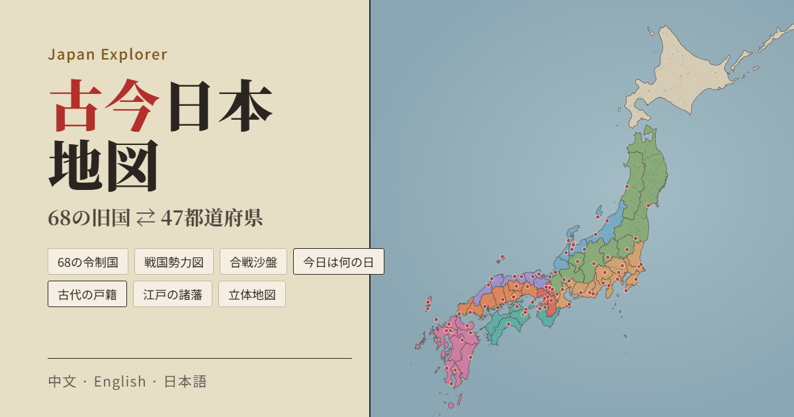
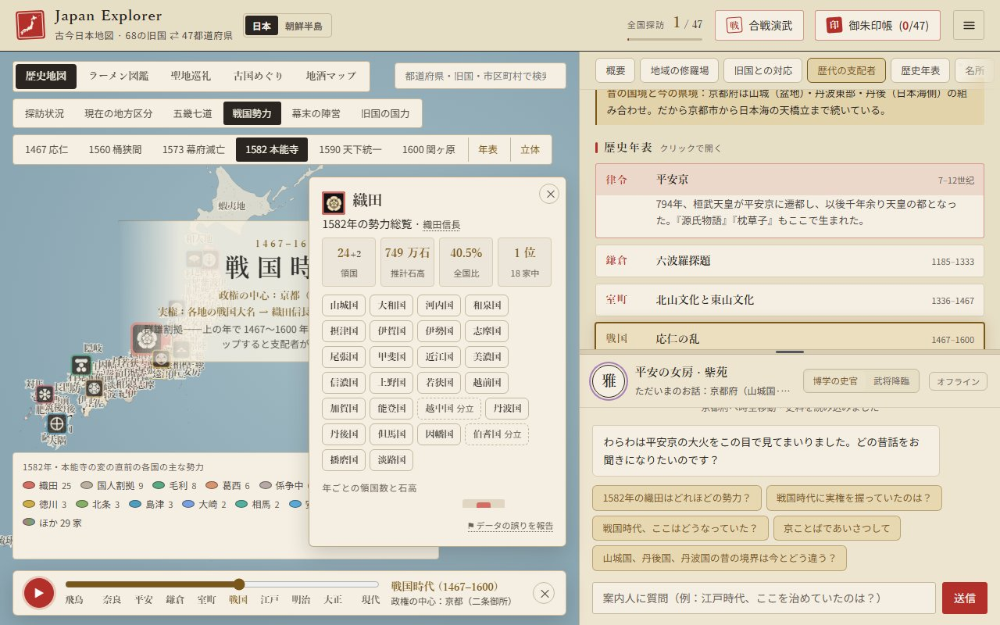
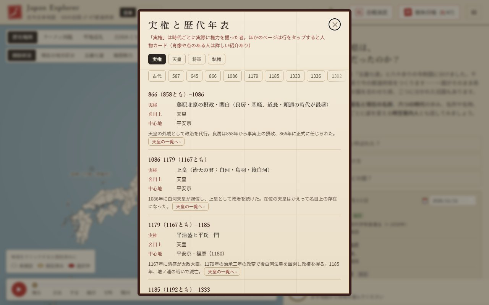
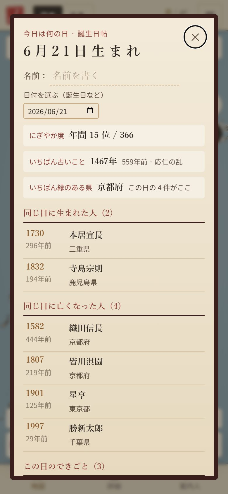
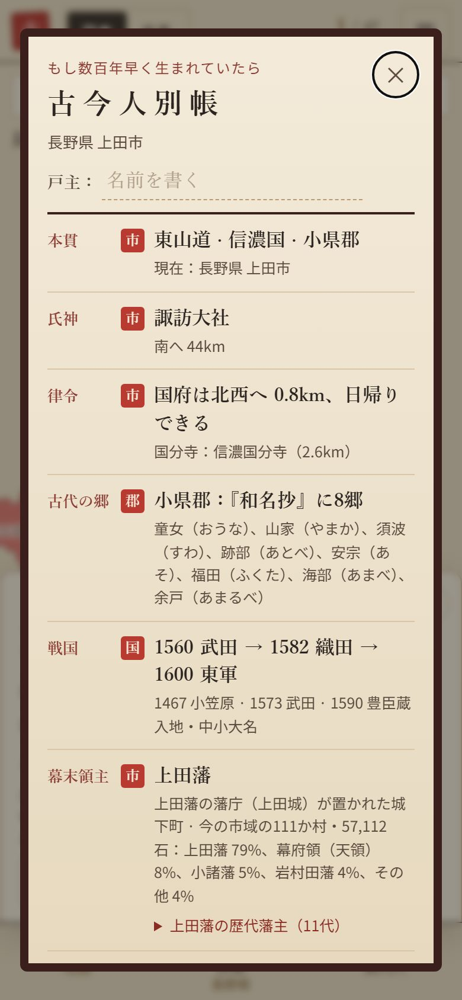
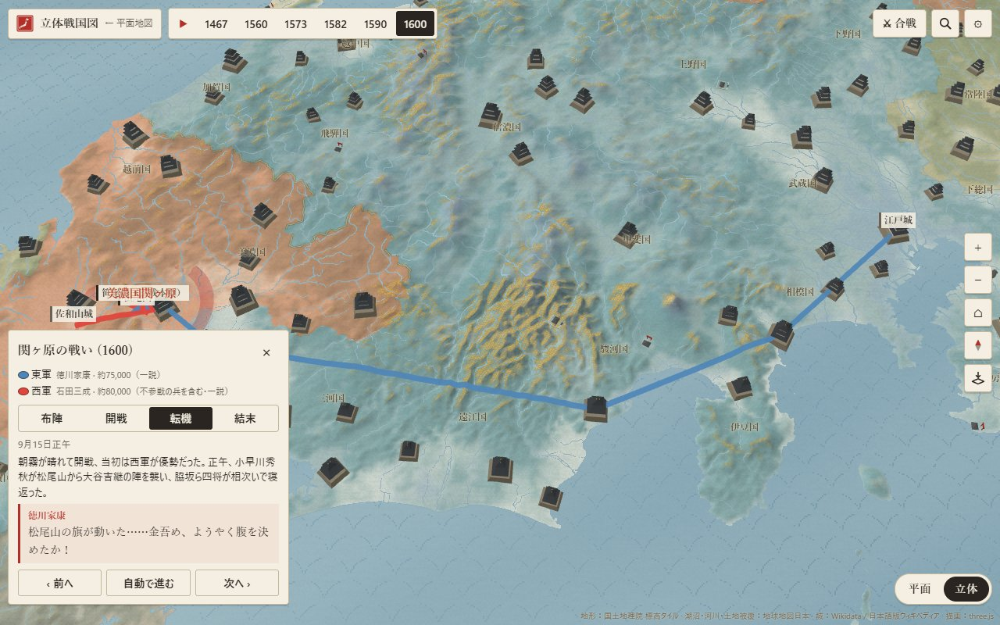

# Japan Explorer · 古今日本地図

[中文](README.md) | [English](README.en.md) | **日本語**

[](https://github.com/Nickrockwall/japan-explorer/actions/workflows/checks.yml)

**▶ 開く：https://nickrockwall.github.io/japan-explorer/**



千年前の日本を今の地図に重ねて。今の47都道府県は、68の令制国のどれだったのか。戦国時代は誰の国で、江戸時代はどの藩の領地で、何百年前の今日そこで何があったのか。県や市町村を選ぶか、スマホの現在地から、足もとの土地が各時代に誰の支配だったかをたどれます。朝鮮半島に切り替えて、新羅・高麗・朝鮮八道と今を見比べることもできます。

<p>
  
  
</p>
<p>
  
  
</p>
<p>
  
</p>

## まずはこのあたりから

- [あなたの誕生日](https://nickrockwall.github.io/japan-explorer/#bday=06-21&lang=ja)：その日に生まれた人・亡くなった人・できごと（リンクは本能寺の変の6月21日。画面で自分の誕生日に変えられます）
- [1582年の日本](https://nickrockwall.github.io/japan-explorer/#pref=26&sg=1582&sgc=oda&lang=ja)：本能寺の変の直前、68か国はそれぞれ誰の国で、織田家は全国のどれほどを握っていたか
- [長野県上田市の古代の戸籍](https://nickrockwall.github.io/japan-explorer/#pref=20&muni=1&m=20203&koseki=1&lang=ja)：数百年早く生まれていたら、戸籍には何と書かれたか。最後の年表は信濃国から長野県まで
- [立体地図の関ヶ原](https://nickrockwall.github.io/japan-explorer/3d.html#bt=sekigahara&ph=2&lang=ja)：本物の地形の上で東西両軍の進軍と小早川の寝返りを見る。年の列の ▶ を押すと 1467 年から 1600 年まで、年と年のあいだの出来事に飛びながら語ります
- [誰が実権を握ったか](https://nickrockwall.github.io/japan-explorer/#rl=power&lang=ja)：ヤマト王権から現在まで、名目上の最高位と実際の実力者
- [朝鮮半島](https://nickrockwall.github.io/japan-explorer/#map=korea&lang=ja)：南北29の一級行政区と歴代の区画

## ちょっと意外な話

- 今の人口を旧国ごとに足し直すと、**武蔵一国に日本の21%**（約2,588万人）。人口の少ない43か国を合わせたより多くなります。**隠岐**は約1.9万人で、東京ドームの半分も埋まりません。
- **佐渡**の人口は江戸時代（1721年）の57%。一方**河内**は江戸の人口43位から今は8位に。
- 江戸時代の498藩のうち、1871年の廃藩置県まで続いたのは265藩。越後の**高田藩**は藩主の家が9度替わり、32代を数えます。
- 収録した「今日は何の日」でいちばんにぎやかなのは**1月15日・3月24日・5月15日**（各12件。3月24日は桜田門外の変の日）。
- 廃藩置県の後、今の**香川県**は置かれては消えました：高松県 → 香川県 → 名東県 → 香川県 → 愛媛県、1888年にようやく香川県が再設置。
- 上田市のあたりは信濃国小県郡。幕末、この郡の158町村のうち106が上田藩領でした。

どれもサイトのデータから出した数字で、ひとつずつ確かめられます。

## 中身

**地図**
- 47都道府県 ⇄ 68令制国の実際の境界を五畿七道で色分け。712・757・824・1869年を切り替えて国の分立や統合も
- 1,900以上の市区町村を旧国または人口で色分けし、明治の郡も表示。検索は漢字・かな・英語に対応
- 時空スライダーで飛鳥から現代まで十の時代の勢力図と都を（報幕にはその時代に実権を握った者も）

**歴史**
- 県ごとの詳細カード：旧国名と今の名前、律令から近現代までの六つの時代、名所・名物・方言
- 戦国勢力図：68か国が1467・1560・1573・1582・1590・1600年の六つの年に誰の国だったか。国を開くと各年の代表人物も。年表（ヤマト王権から現在まで各時代に実権を握った者、天皇・将軍・執権の一覧）と61人の紹介・肖像。地図右側の「立体」で立体地図にも：3D の地形、全国五百近くの城、各家の旗指物、屏風絵の色づかい。再生すると年と年のあいだの 33 の出来事を語り、地形の上で合戦を再現でき、京都にはその年の「天下」の持ち主
- 合戦演武：桶狭間・川中島・関ヶ原・壇ノ浦・西南戦争を4段階で再現し、武将がみずから解説
- 江戸の諸藩：498藩の歴代藩主を県ごとに。藩主名の後ろに誕生日・忌日があり、押すと場所を地図に示します
- 旧国の国力：68か国の今の人口・江戸の人口・石高・「三百年の逆転」ランキング、宿敵対決（伊賀 vs 甲賀、尾張 vs 三河…）
- 広重「六十余州名所図会」全69図と描かれた場所の今。旧国名が今も残る190のもの（信濃川、讃岐うどん、伊予柑…）

**あなたのこと**
- 今日は何の日：何百年前の今日、日本で何があったか。できごと、歴史上の人物と近代の著名人の誕生・忌日を、366日すべての日に。人によって並び順が違います
- 誕生日帖：日付（誕生日など）を選ぶと、その日の全項目と、366日の中で何番目ににぎやかな日か、いちばん縁のある県はどこかを表示。名前を入れて画像で保存も
- 現在地：いま立っているのが昔のどの国・どの郡か
- 古代の戸籍：《古今人別帳》に氏神、国府までの距離、戦国の勢力、幕末の領主、戊辰戦争の立場、お国言葉を。最後の「この地の年表」は、この地の支配者の移り変わり（江戸の藩と各家、廃藩置県後の県。沖縄・北海道・奄美はそれぞれの歴史に沿って）と、ここで起きた出来事・生まれた人を一本の線に。各欄に市・郡・県・国のどの単位かを明記し、画像で保存も
- 御朱印帳：訪れた県ごとに一枚。諸国一宮はサイト上で参拝でき、神社の近くにいれば「現地参拝」の御朱印も

**気軽に**
- ラーメンの系統、地酒、アニメ聖地と大河ドラマのロケ地（111か所）、各県のご当地あるある
- 地域ごとに姿を変える案内人（平安の女房、浮世絵の猫、武将…）。AI なしでもクイック質問に答えます
- 和風の効果音と箏の BGM。すべてブラウザ内で合成

**朝鮮半島**（タイトル横の「日本 / 朝鮮半島」）
- 南北29の一級行政区（2026年現在の区画）。400以上の市郡区へ下りられ、地名は日本語・ハングル・ローマ字で
- 歴代の区画：三国、統一新羅の九州、高麗の五道両界、朝鮮八道、1896年の十三道。八道の図では道名の由来の二つの町を表示（慶尚＝慶州＋尚州……）
- 1432年『世宗実録』地理志の戸口・墾田ランキング、六つの古戦場、金正浩『大東輿地図』に描かれた各区
- 半島印帳と141の郷校の現地チェックイン、各区の無形文化財の伝統酒
- 日本と朝鮮半島の共通の歴史9件を「双方が認める事実 / 各側の主流の語り方 / 出典」の三層で。独島 / 竹島、日本海 / 東海のように争いのある名前は二つを並べ、各側の立場だけを示します

初めて開いたときは使い方ガイドが出ます（設定からいつでも再表示）。表示言語は中文・English・日本語。

## 使い方

- **スマホ**：ブラウザでリンクを開くだけ。縦でも横でも使えます。ホーム画面に追加するには、iPhone は Safari の共有 →「ホーム画面に追加」、Android は Chrome の ⋮ →「ホーム画面に追加」。一度見た内容はオフラインでも表示できます。
- **パソコン**：左に地図、右に詳細と案内人。
- **共有**：カードの「共有」ボタンで地域と言語つきのリンクをコピー。例：`#pref=26&lang=ja` で日本語の京都が開きます。誕生日帖・古代の戸籍・戦国勢力図にもそれぞれのリンクがあります。
- **AI（任意）**：案内人と自由に話したいときは「API 設定」に自分のキーを入力。Claude・Gemini・OpenAI 互換（DeepSeek など）に対応。キーはブラウザ内にだけ保存され、リクエストはブラウザから指定先へ直接送られます。このサイトは経由しません。
- **誤りの報告**：各カードの最後の「データの誤りを報告」から、カード名と今のリンクを記入済みの GitHub issue を開けます（GitHub へのログインが必要）。
- **プライバシー**：アカウントもアクセス解析もありません。位置情報はボタンを押したときだけ使い、端末内で計算して送信しません。探訪の記録・御朱印・名前もブラウザ内にだけ保存されます。

## データの出典と正確さ

内容にはできるかぎり出典をつけ、近似の部分は画面上で明記しています。

- **境界**：全国地図は「地球地図日本」（国土地理院）、市区町村の境界は「国土数値情報（行政区域データ）」（国土交通省）を加工して作成。旧国の境界は市区町村をつなぎ合わせたもので、二国にまたがる市町村は主な国に含めるため近似です。
- **日本語版ウィキペディア**（CC BY-SA 4.0）：明治の郡、諸国一宮・国府・国分寺、江戸時代の国別人口と石高、1598年の太閤検地の国高、幕末の郡ごとの領主（旧高旧領取調帳）、江戸の諸藩と歴代藩主、1889年の町村制の町村、市名の由来（独自の要約、キーワードを記事と照合。記事に書かれていない市は市・県の公式サイトと照合）、戦国時代の各国の守護・大名、「N月N日」の日付記事。座標がその国に収まるか、名前が記事に本当に出てくるかなどをスクリプトで確認し、合わないものは載せていません。
- **国立歴史民俗博物館「旧高旧領取調帳データベース」**：古代戸籍の市区町村単位の幕末領主——今の市区町村に入る明治初年の各村の領主と石高を合計（集計結果のみを掲載し、元の記録は転載していません）。
- **CODH（人文学オープンデータ共同利用センター）**（CC BY 4.0）：「歴史的行政区域データセットβ版」の1920・1985・1995年の市区町村界（ウィキペディアにない明治の町村の補完と、旧高旧領の村を今の市区町村に当てるため）、「『日本歴史地名大系』地名項目データセット」の村の位置。
- **奈良文化財研究所「古代地名検索システム」**：『和名類聚抄』（10世紀）の各郡の郷名と読み。
- **Wikidata**（CC0）：市区町村の読み・人口・英語名。ウィキペディアに在任年のない藩主は「○○藩主」の職の在任期間から（それもなければ英語版ウィキペディアの藩の記事の藩主表から）。「今日は何の日」の日付・場所・三言語の名前——できごとと人物は年月日が Wikidata と一致し、場所がどこかの県に収まるものだけを収録。近代の人物は日本語版ウィキペディアの2025年の年間閲覧数で選び、1日2〜3人まで。日付はグレゴリオ暦で、1582年以前はユリウス暦（ウィキペディアと同じ）。
- **朝鮮半島**：境界は geoBoundaries（韓国：Natural Earth、citypopulation.de／北朝鮮：WFP・OCHA ROAP）、名称と人口は Wikidata。韓国語版ウィキペディアで2026年現在の区画に更新。歴代の区画は今の市郡から組み立て、新羅の九州は韓国語版ウィキペディアの表、高麗は『高麗史』地理志によるもので、いずれも近似です。1432年の戸口・墾田は『世宗実録』地理志の原文（国史編纂委員会「朝鮮王朝実録」サイト）。『大東輿地図』はソウル大学校奎章閣所蔵本（パブリックドメイン）で、各区の範囲は古地図を今日の海岸線と重ねて推定しています。
- **画像**：歌川広重の作品、47都道府県の県章、『大東輿地図』はパブリックドメイン。人物の肖像も多くはパブリックドメインで、2点は CC BY-SA（カードに作者を明記）。戦国勢力図の家紋は日本語版ウィキペディアの各家の記事から取り、パブリックドメインまたは CC BY / BY-SA（勢力総覧に作者と許諾を明記）。いずれも Wikimedia Commons より。
- **本サイトで書いた部分**：人物紹介・沿革・ご当地あるある・ラーメン・地酒は通説に基づき、出てくる年と出来事はウィキペディアで確認しています。色分けには県や国の主導勢力だけを示す近似もあり、不確かな点は「一説に」「伝承では」と記しています。気軽な閲覧向けで、学術的な引用には向きません。

## ライセンス

© 2026 Nickrockwall

- **コード**：[MIT](LICENSE)
- **コンテンツ**（史料の文章、案内人の設定と回答、翻訳、カバー画像とアイコン）：[CC BY-NC 4.0](https://creativecommons.org/licenses/by-nc/4.0/deed.ja)。「Japan Explorer by Nickrockwall」とリンクを記せば転載・改変可、商用不可
- **第三者の素材**はそれぞれの条件に従います。ウィキペディア由来のデータは CC BY-SA 4.0 で、NC は適用されません。一覧は [LICENSE-CONTENT.md](LICENSE-CONTENT.md)

各バージョンの変更点：[CHANGELOG.ja.md](CHANGELOG.ja.md)

## 開発

静的サイト：素の HTML / CSS / ES Modules。地図は [Apache ECharts](https://echarts.apache.org/) を必要な部品だけでビルドして同梱、明朝体も同梱（中国本土のネットワークでも開けます）。ビルド工程はありません。

```bash
python -m http.server 8000          # ローカルで動かして http://localhost:8000 を開く（index.html をダブルクリックでは動きません）
python tools/build_bundle.py        # src/data の JSON を変えたら必ず再パック
python -X utf8 tools/check_data.py  # データチェック
python -X utf8 tests/smoke.py       # UI テスト（pip install playwright && python -m playwright install chromium）
```

GitHub にプッシュすると、データチェックと UI テスト（パソコン・タブレット・スマホ縦横 × 中英日）が走り、すべて通ったときだけ GitHub Pages に公開されます。データ形式、`tools/` の各ツールの使い方、約束事は [CLAUDE.md](CLAUDE.md) にあります。
