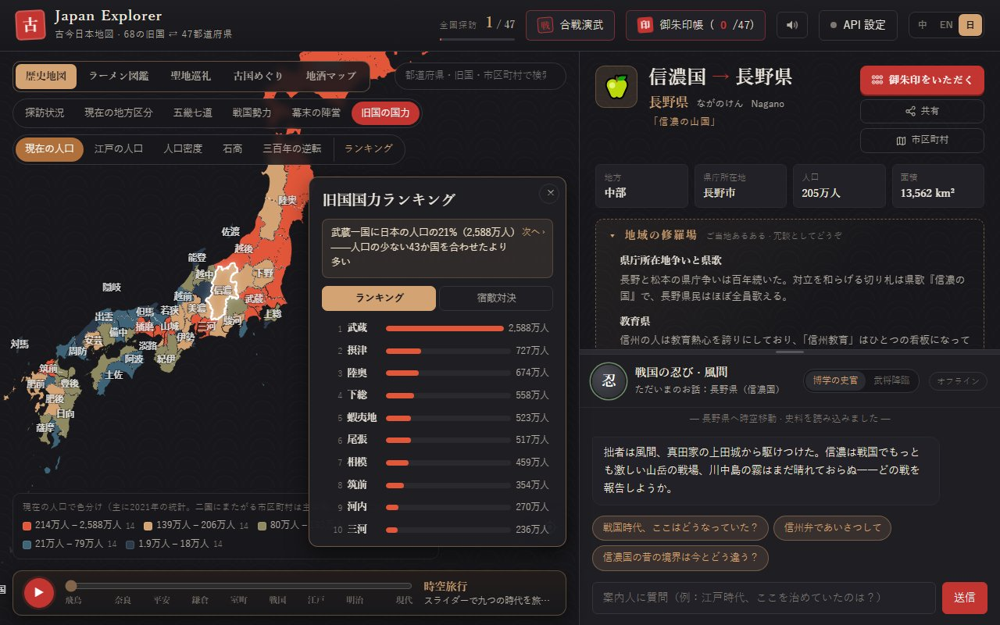
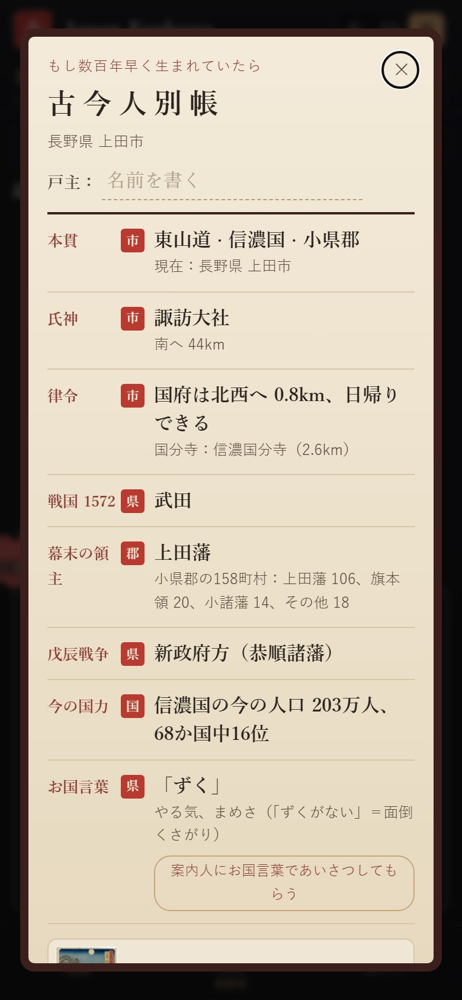

# Japan Explorer · 古今日本地図

[中文](README.md) | [English](README.en.md) | **日本語**

[](https://github.com/Nickrockwall/japan-explorer/actions/workflows/checks.yml)

**▶ 開く：https://nickrockwall.github.io/japan-explorer/**


千年前の日本を今の地図に重ねて。今の47都道府県は、68の令制国のどれだったのでしょう？県や市町村を選ぶか、スマホの現在地から、足もとの土地が各時代に誰の支配だったかをたどれます。

<p>
  
  
</p>

## ちょっと意外な話

- 今の人口を旧国ごとに足し直すと、**武蔵一国に日本の21%**（約2,588万人）。人口の少ない43か国を合わせたより多くなります。
- **隠岐**の人口は約1.9万人。東京ドームの半分も埋まりません。
- **佐渡**の人口は江戸時代（1721年）の57%。一方**河内**は江戸の人口43位から今は8位に。
- 長野県上田市のあたりは信濃国小県郡。幕末、この郡の158町村のうち106が上田藩領でした。

どれもサイトの「旧国の国力」と「古代の戸籍」から出した数字で、ひとつずつ確かめられます。

## できること

**地図を見る**
- 古今の対照：47都道府県 ⇄ 68令制国の実際の境界を五畿七道で色分け。712・757・824・1869年を切り替えて国の分立や統合も
- 1,900以上の市区町村：旧国または人口で色分けし、明治の郡も表示。検索は漢字・かな・英語に対応
- 時空旅行：スライダーで飛鳥から現代まで九つの時代の勢力図と都を

**歴史を読む**
- 県ごとの詳細カード：旧国名と今の名前、律令から近現代までの六つの時代、名所・名物・方言
- 合戦演武：桶狭間・川中島・関ヶ原・壇ノ浦・西南戦争を4段階で再現し、武将がみずから解説
- 今日は何の日：何百年前の今日、日本で何があったか（できごと・歴史上の人物の誕生と忌日）。人によって違う並びで、誕生日も調べられる
- 江戸の諸藩：261藩の歴代藩主を県ごとに
- 戦国勢力図：68か国が1467年 応仁・1560年 桶狭間・1573年・1582年 本能寺・1590年・1600年 関ヶ原の六つの年に誰の国だったか。国を開くと各年の代表人物も。天皇・将軍年表と61人の紹介・肖像
- 旧国の国力：68か国の今の人口・江戸の人口・石高・「三百年の逆転」ランキング、宿敵対決（伊賀 vs 甲賀、尾張 vs 三河…）
- 広重「六十余州名所図会」全69図と描かれた場所の今。旧国名が今も残る190のもの（信濃川、讃岐うどん、伊予柑…）

**あなたのこと**
- 現在地：いま立っているのが昔のどの国・どの郡か
- 古代の戸籍：《古今人別帳》に氏神、国府までの距離、戦国の勢力、幕末の領主、戊辰戦争の立場、お国言葉を。各欄に市・郡・県・国のどの単位かを明記し、画像で保存も
- 御朱印帳：訪れた県ごとに一枚。諸国一宮はサイト上で参拝でき、神社の近くにいれば「現地参拝」の御朱印も

**気軽に**
- ラーメンの系統、地酒、アニメ聖地と大河ドラマのロケ地（111か所）、各県のご当地あるある
- 時空案内人：地域ごとに姿を変える案内人（平安の女房、浮世絵の猫、武将…）。AI なしでもクイック質問に答えます
- 和風の効果音と箏の BGM。すべてブラウザ内で合成

初めて開いたときは9ステップの使い方ガイドが出ます（設定からいつでも再表示）。表示言語は中文・English・日本語。

## 朝鮮半島モード

タイトル横の「日本 / 朝鮮半島」で半島の地図に切り替わります（`#map=korea` でも開けます）：

- 南北29の一級行政区（2026年現在の区画）。日本語・ハングル・ローマ字の表記、六つの時代の沿革、名所・名産・方言。400以上の市郡区へ下りられます
- 歴代の区画：統一新羅の九州、高麗の五道両界、朝鮮八道、1896年の十三道。八道の図では道名の由来の町を表示（慶尚＝慶州＋尚州……）
- 現在地 / 古今戸籍：足元の土地が新羅・高麗・朝鮮・1896年にどこに属したか
- 半島印帳：29区それぞれにハングルの角印。「郷校篇」には141の郷校があり、1 km以内なら現地チェックインできる
- 各区の伝統酒（無形文化財や食品名人に指定されたものだけ）と、金正浩『大東輿地図』（1861年）に描かれたその地
- 日本と朝鮮半島の共通の歴史：渡来人から拉致問題までの9件を「双方が認める事実 / 各側の主流の語り方 / 出典」の三層で。両モードで同じ内容
- 係争のある場所は二つの名前を並べ、各側の立場だけを示します：独島 / 竹島、日本海 / 東海。日本モードの竹島・北方領土も同じ方針で表示
- 丹青の配色と伽耶琴風のBGM。案内人「丹青」は AI なしでも答えます

## 使い方

- **スマホ**：ブラウザでリンクを開くだけ。縦でも横でも使えます。ホーム画面に追加するには、iPhone は Safari の共有 →「ホーム画面に追加」、Android は Chrome の ⋮ →「ホーム画面に追加」。一度見た内容はオフラインでも表示できます。
- **パソコン**：リンクを開くと、左に地図、右に詳細と案内人。
- **共有**：カードの「共有」ボタンで地域と言語つきのリンクをコピー。例：`#pref=26&lang=ja` で日本語の京都が開きます。

**AI（任意）**：案内人と自由に話したいときは「API 設定」に自分のキーを入力。Claude・Gemini・OpenAI 互換（DeepSeek など）に対応。キーはブラウザ内にだけ保存され、リクエストはブラウザから指定先へ直接送られます。このサイトは経由しません。

**プライバシー**：アカウントもアクセス解析もありません。位置情報はボタンを押したときだけ使い、端末内で計算して送信しません。探訪の記録・御朱印・戸主名もブラウザ内にだけ保存されます。

## データの出典と正確さ

地図の内容にはできるかぎり出典をつけ、近似の部分は画面上で明記しています。

- **境界**：全国地図は「地球地図日本」（国土地理院）、市区町村の境界は「国土数値情報（行政区域データ）」（国土交通省）を加工して作成。旧国の境界は市区町村をつなぎ合わせたもので、二国にまたがる市町村は主な国に含めるため近似です。
- **日本語版ウィキペディアのデータ**（CC BY-SA 4.0）：明治の郡、諸国一宮・国府・国分寺、江戸時代の国別人口と石高、幕末の郡ごとの領主（旧高旧領取調帳）。座標がその国に収まるかなどをスクリプトで確認し、合わないものは載せていません。
- **Wikidata**（CC0）：市区町村の読み・人口・英語名、藩の英語名。
- **朝鮮半島**：境界は geoBoundaries（韓国：Natural Earth、citypopulation.de／北朝鮮：WFP・OCHA ROAP）、名称と人口は Wikidata。韓国語版ウィキペディアで2026年現在の区画（全南光州統合特別市、仁川の新区など）に更新。歴代の区画は今の市郡から組み立て、新羅の九州は韓国語版ウィキペディアの九州の表にある現在地、高麗の五道両界は『高麗史』地理志、三国（500年ごろ）は九州の由来から推定したもので、いずれも近似です。1432年の戸口・墾田は『世宗実録』地理志の原文（国史編纂委員会「朝鮮王朝実録」サイト）、古戦場の本文は韓・英・日のウィキペディアと照合しています。郷校の位置は Wikidata（北側は確かめられる資料がまだない）、伝統酒は韓国語版ウィキペディアの無形文化財・食品名人の一覧から。『大東輿地図』はソウル大学校奎章閣所蔵本（パブリックドメイン）で、各区の範囲は古地図を今日の海岸線と重ねて推定しています。
- **浮世絵・県章・人物の肖像**：歌川広重の作品と47都道府県の県章はパブリックドメイン。人物の肖像も多くはパブリックドメインで、2点は CC BY-SA（カードに作者を明記）。画像は Wikimedia Commons より。
- **戦国勢力と人物**：各国の年ごとの支配者と、天皇・将軍・執権の在位年は日本語版ウィキペディアの守護一覧・一覧記事・人物記事をもとに整理し、一件ずつスクリプトで照合。人物紹介は本サイトで執筆し、出てくる年と出来事は人物記事で確認済み。複数の勢力が分け合う国は主な一方のみを色分けした近似です。
- 史実・ご当地あるある・ラーメン・地酒は通説に基づき、色分けには近似もあります（県内の主導勢力で塗るなど）。不確かな点は「一説に」「伝承では」と記しています。気軽な閲覧向けで、学術的な引用には向きません。

## ライセンス

© 2026 Nickrockwall

- **コード**：[MIT](LICENSE)
- **コンテンツ**（史料の文章、案内人の設定と回答、翻訳、カバー画像とアイコン）：[CC BY-NC 4.0](https://creativecommons.org/licenses/by-nc/4.0/deed.ja)。「Japan Explorer by Nickrockwall」とリンクを記せば転載・改変可、商用不可
- **第三者の素材**はそれぞれの条件に従います。ウィキペディア由来のデータは CC BY-SA 4.0 で、NC は適用されません。一覧は [LICENSE-CONTENT.md](LICENSE-CONTENT.md)

各バージョンの変更点：[CHANGELOG.ja.md](CHANGELOG.ja.md)

## 開発

静的サイト：素の HTML / CSS / ES Modules。地図は [Apache ECharts](https://echarts.apache.org/) を同梱（中国本土のネットワークでも開けます）。ビルド工程はありません。

```bash
python -m http.server 8000          # ローカルで動かして http://localhost:8000 を開く（index.html をダブルクリックでは動きません）
python tools/build_bundle.py        # src/data の JSON を変えたら必ず再パック
python -X utf8 tools/check_data.py  # データチェック
python -X utf8 tests/smoke.py       # UI テスト（pip install playwright && python -m playwright install chromium）
```

GitHub にプッシュすると、データチェックと UI テスト（パソコン・タブレット・スマホ縦横 × 中英日）が走り、すべて通ったときだけ GitHub Pages に公開されます。データ形式、`tools/` の各ツールの使い方、約束事は [CLAUDE.md](CLAUDE.md) にあります。
