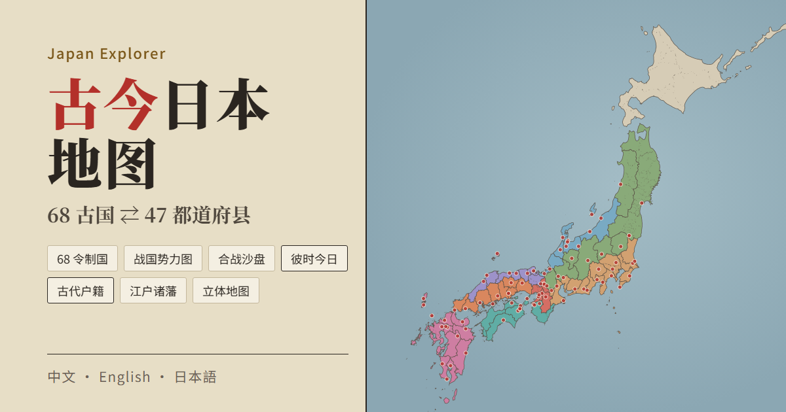
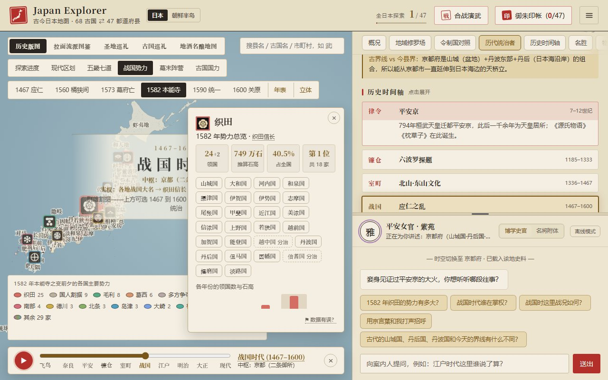
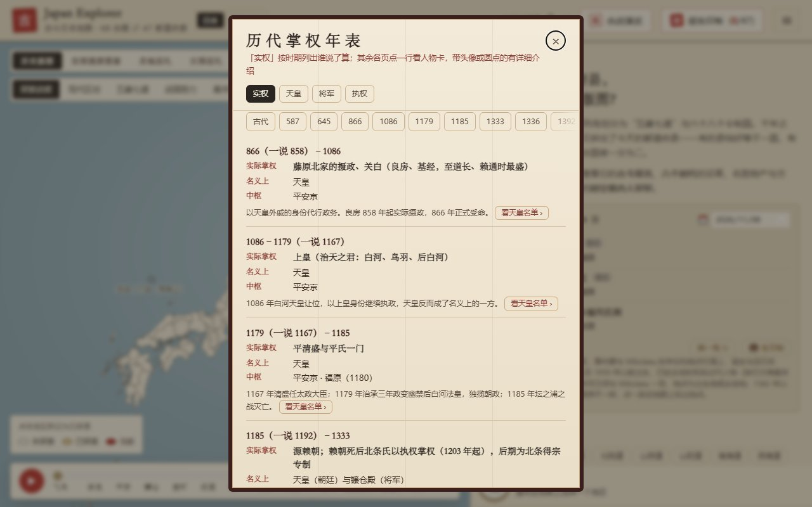
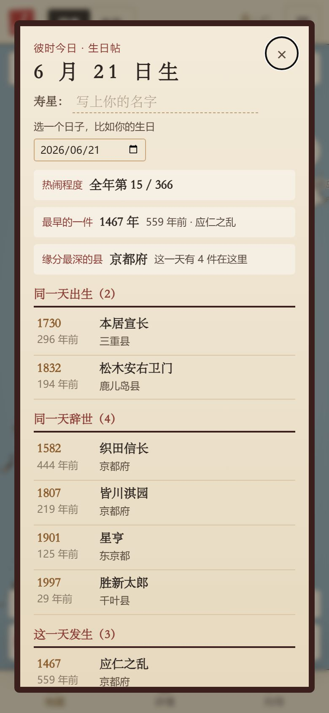
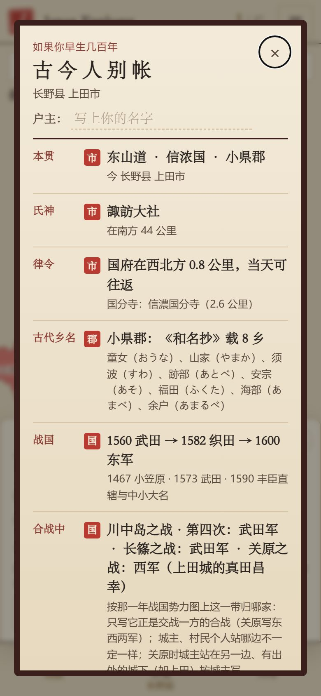
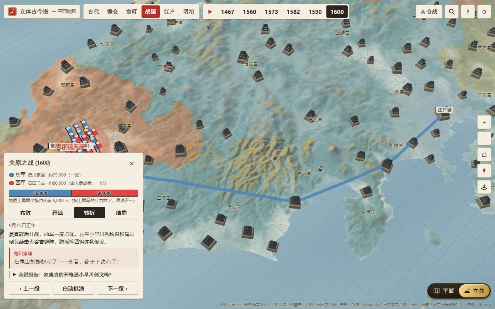

# Japan Explorer · 古今日本地图

**中文** | [English](README.en.md) | [日本語](README.ja.md)

[](https://github.com/Nickrockwall/japan-explorer/actions/workflows/checks.yml)

**▶ 在线打开：https://nickrockwall.github.io/japan-explorer/**



这是一张把古代日本叠在今天地图上的网页。今天的 47 个都道府县，一千多年前分属 68 个令制国中的哪几个？到了战国，这块地归哪家大名？江户时代归哪个藩？废藩置县以后，又先后属于哪个县？

点一个县、一个市区町村，或者让手机定位，就能看到脚下这块地在各个时代归谁管。网页不用注册，打开就能用，有中文、English、日本語三种界面。

<p>
  
  
</p>
<p>
  
  
</p>
<p>
  
</p>

## 先点开这几个看看

- [长野县上田市的古代户籍](https://nickrockwall.github.io/japan-explorer/#pref=20&muni=1&m=20203&koseki=1&lang=zh)：如果早生几百年，你的户籍上会写什么。从信浓国、真田家一路写到长野县，连附近发生过的大地震也列在里面。
- [1582 年的日本](https://nickrockwall.github.io/japan-explorer/#pref=26&sg=1582&sgc=oda&lang=zh)：本能寺之变前夕，68 国各归哪家，织田家占了全国几成。
- [谁在掌权](https://nickrockwall.github.io/japan-explorer/#rl=power&lang=zh)：从大和王权到今天分成 20 段，每段写出名义上是谁、实际说了算的是谁。
- [立体地图上的关原之战](https://nickrockwall.github.io/japan-explorer/3d.html#bt=sekigahara&ph=2&lang=zh)：在真实地形上看东西两军怎么进军，小早川又是怎么倒戈的。
- [1400 年的守护大名](https://nickrockwall.github.io/japan-explorer/3d.html#y=1400&lang=zh)：立体地图上的室町时代，细川、山名、上杉、大内各守着哪几国。
- [你生日那天](https://nickrockwall.github.io/japan-explorer/#bday=06-21&lang=zh)：这一天出生、去世的人和发生的事。链接是 6 月 21 日（本能寺之变那天），可以换成你自己的生日；填上出生年份，还能看到历史人物在你这个岁数时做了什么。

## 查查你的家乡

- **古代户籍《古今人别帐》**：选一个市区町村，按时代列出这里的来历。有氏神、到国府的距离、《和名抄》里的乡名、战国时归谁、关原之战站哪边、幕末领主（按旧高旧领精确到市区町村）、明治的町村、平成大合并前的市町村、地名来历、同乡名人，附近的大地震、海啸和火山喷发，还有绳文时代这里是不是海、最近的古坟、附近的古战场、五十年的人口变化、此地的国宝；填上户主名，还会列出同姓、写明出身地的氏族。各栏按古代、战乱、江户、近现代、这片土地分组。每一栏都注明精确到市、郡、县还是国，整张户籍可以存成图片。
- **我在哪**：用手机定位，告诉你此刻身在哪个古国、哪个郡。位置只在本机计算。
- **搜索**：县、古国、市区町村、人物、城、藩、合战都能搜，比如搜「上田」会同时列出上田市、上田城和上田藩。
- **彼时今日与生日帖**：几百年前的今天发生了什么，一年 366 天每天都有。选一个日子，就能列出这一天的全部条目，也可以存成图片。
- **御朱印帐**：每到一个县盖一枚印。在诸国一宫附近还能盖「亲临」印。「真实足迹」篇会读取你选的照片里的拍摄地点，标出你到过 68 国里的哪几国；照片不会上传。

## 看地图

**平面地图**
- 47 都道府县与 68 令制国的边界，按五畿七道着色，可以切换 712 / 757 / 824 / 1869 年，看古国的分合；也能下钻到 1,902 个市区町村。
- **时空滑块**：从飞鸟到现代共十个时代。镰仓、室町、江户、明治用的是真实边界（各国守护、各藩领地、当年的府县），横幅上写着这个时代实际由谁掌权。
- **战国势力图**：1467、1560、1573、1582、1590、1600 六个年份，68 国各归哪家；附各家家纹旗、势力总览和代表人物（61 位有介绍与肖像）。
- **年表**：各时期的实权、126 代天皇、历代将军与镰仓执权。
- **还有**：江户 505 个藩的历代藩主；古国国力榜（今天人口、江户人口、石高），以及市区町村的「逆袭榜」；歌川广重《六十余州名所图会》全 69 幅；190 样至今还带着旧国名的东西。
- **每县一张详卡**：古今地名、六段沿革、名胜、物产、方言、拉面、地酒、动漫与大河剧的取景地。

**立体地图**（地图右侧的「平面 | 立体」开关）
- 在真实地形上看几个时代：古代的五畿七道与官道、镰仓与室町的各国守护、战国大名、江户的藩领与五街道、明治的府县与铁路。配色仿屏风画。
- 812 座城，其中 100 名城和现存天守有标记、166 座附实景照片。点一座城，能看到这一带历年归谁；也可以登上天守环顾四周，算出能望见哪几座百名山。
- 点 ▶ 从 712 年一路讲到 1888 年：每两个年份之间，先飞去看这期间发生了什么（共 76 件事）。
- **此地千年**：手机上长按、电脑上右键单击任意一处，镜头就停在那里，从 712 年列到 1888 年，这里属于哪一国、归谁管。

**合战**
- 共 16 场，从一之谷、凑川到大坂夏之阵、西南战争。平面地图和立体地图都能重演，每场分四个阶段，由名将本人解说。附兵力对比，以及史家意见不一的「众说纷纭」。

**时空案内人**
- 向导会随地区换身份（平安女官、浮世绘猫、名将……）。不接 AI 也能回答常见问题；填上自己的 API Key 后可以自由对话。

## 几个你可能不知道的事

- 把今天的人口按古国重新加起来，**武藏一国**住着全日本约 21% 的人（约 2,588 万），比人口最少的 43 个国加起来还多；**隐岐**只有约 1.9 万人，坐不满半座东京巨蛋。
- **佐渡**今天的人口只有江户时代（1721 年）的 57%；**河内**则在 68 国中从江户人口第 43 名升到今天的第 8 名。
- 江户时代的 505 个藩里，撑到 1871 年废藩置县的有 269 个；越后**高田藩**前后换过 9 家藩主，共 32 代。
- 废藩置县以后，今天的**香川县**撤了又设：高松县 → 香川县 → 名东县 → 香川县 → 爱媛县，直到 1888 年才再次设立香川县。
- 关原之战时，信浓国大体站在东军一边，但上田城的**真田昌幸**属于西军，所以上田市的户籍按城主写成西军。

这些都是从网站里的数据算出来的，每一条都能自己点开看。

## 怎么用

- **手机**：用浏览器打开上面的链接，竖屏、横屏都能用。想放到手机桌面：iPhone 在 Safari 里点「分享 → 添加到主屏幕」，Android 在 Chrome 里点「⋮ → 添加到主屏幕」。看过的内容离线也能打开。
- **电脑**：左边是地图，右边是详卡和向导。横排的按钮行（年表跳转、滤镜、图例）可以用滚轮或按住拖动来横向滑动。
- **分享**：详卡的「分享」会复制一个带地区和语言的链接（比如 `#pref=26&lang=ja` 是日语版的京都）。户籍、生日帖、战国图、年表，以及立体地图的年份与合战，也都有自己的链接。
- **接入 AI（可选）**：在菜单的「设置」里填自己的 Key，就能和向导自由对话。支持 Claude、Gemini 和 OpenAI 兼容接口（包括 DeepSeek、通义千问）。Key 只存在你的浏览器里，请求由浏览器直接发给你填写的接口。
- **纠错**：每张卡片末尾都有「数据有误？」。点一下会在 GitHub 上新建一条 issue，自动写好是哪张卡片和当前的链接。
- **隐私**：网站没有账号，也不做访问统计。探索进度、御朱印和名字都只存在你自己的浏览器里。

## 数据从哪来、准不准

每条资料都尽量注明出处，并用脚本核对过：坐标是否真的落在所属的国内，名字和年份是否真的出现在原条目里，等等。对不上的就不收；近似的地方会在界面上直接说明。

- **边界**：全国地图出自「地球地図日本」（国土地理院）；市区町村边界为「国土数値情報（行政区域データ）」（国土交通省）を加工して作成。68 国的国界由市区町村拼成，横跨两国的市町村算给主要一方，所以是近似。立体地图的地形取自国土地理院的标高瓦片。
- **日文维基百科**（CC BY-SA 4.0）：旧郡、一宫·国府·国分寺、江户人口与石高、幕末各郡的领主、江户诸藩与藩主、明治町村、各国的守护与战国大名、城的筑城年、人物的生卒年、地震的规模与死者数、「N月N日」条目等。人物介绍、地名来历等说明文字是自己写的，只用条目核对其中的年份与关键词。
- **国立历史民俗博物馆「旧高旧領取調帳データベース」**：精确到市区町村的幕末领主与石高（只放汇总）。
- **CODH**（CC BY 4.0）：1920 / 1985 / 1995 年的市区町村边界，《日本歴史地名大系》中的村落坐标。
- **奈良文化财研究所「古代地名検索システム」**：《和名类聚抄》中各郡的乡。
- **Wikidata**（CC0）：读音、人口、英文名、城与人物的坐标、彼时今日条目的日期与地点。
- **图像**：广重作品与都道府县章为公有领域；人物肖像、家纹与城的照片为公有领域或 CC BY / BY-SA（卡片上注明作者），都取自 Wikimedia Commons。

地图着色只取一国或一郡里的主导一方，属于近似；有争议的地方标注「一说」。适合轻松浏览，不宜作为学术引用。

## 版权与许可

© 2026 Nickrockwall

- **代码**：[MIT](LICENSE)
- **内容**（史料文字、人设与解答、译文、封面与图标）：[CC BY-NC 4.0](https://creativecommons.org/licenses/by-nc/4.0/deed.zh-hans)。注明「Japan Explorer by Nickrockwall」并附上链接，即可转载或改编，但不得用于商业用途。
- **第三方素材**按各自的条款。出自维基百科的数据为 CC BY-SA 4.0，不适用 NC。完整清单见 [LICENSE-CONTENT.md](LICENSE-CONTENT.md)。

各版本的改动见 [CHANGELOG.md](CHANGELOG.md)。

## 开发

这是纯静态网站：原生 HTML / CSS / ES Modules，没有构建步骤。平面地图用 [Apache ECharts](https://echarts.apache.org/)，立体地图用 [three.js](https://threejs.org/)，都和字体一起随站点发布，在国内网络下也能打开。

```bash
python -m http.server 8000          # 本地运行，再打开 http://localhost:8000（不能直接双击 index.html）
python tools/build_bundle.py        # 改了 src/data 里的任何 JSON 之后都要重新打包
python -X utf8 tools/check_data.py  # 数据检查
python -X utf8 tests/smoke.py       # 界面测试（需先 pip install playwright && python -m playwright install chromium）
```

推送到 GitHub 后，会先跑数据检查和界面测试（电脑、平板、手机竖屏与横屏 × 中英日），全部通过才发布到 GitHub Pages。数据结构、`tools/` 里各个整理工具的用法和约定见 [CLAUDE.md](CLAUDE.md)。
