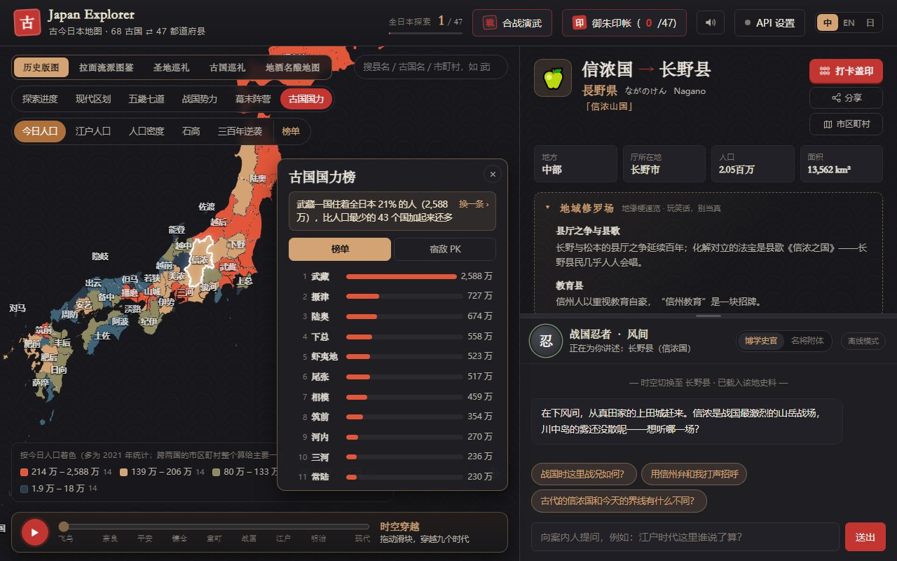
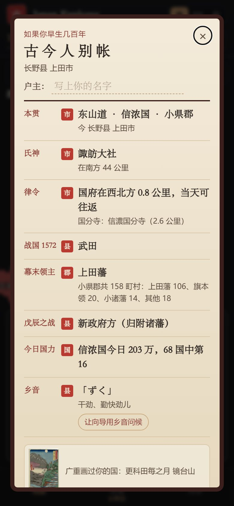

# Japan Explorer · 古今日本地图

**中文** | [English](README.en.md) | [日本語](README.ja.md)

[](https://github.com/Nickrockwall/japan-explorer/actions/workflows/checks.yml)

**▶ 在线打开：https://nickrockwall.github.io/japan-explorer/**


把千年前的日本叠在今天的地图上：今天的 47 都道府县，古时候是 68 个令制国中的哪几个？点一个县、一个市，或者用手机定位，看脚下这片土地在各个时代归谁管。

<p>
  
  
</p>

## 几个你可能不知道的事

- 把今天的人口按古国重新加起来，**武藏一国住着全日本 21% 的人**（约 2,588 万），比人口最少的 43 个国加起来还多。
- **隐岐**全国只有约 1.9 万人，坐不满半座东京巨蛋。
- **佐渡**今天的人口只有江户时代（1721 年）的 57%；**河内**则从江户人口第 43 名升到今天第 8。
- 长野县上田市一带属于信浓国小县郡；幕末这个郡的 158 个町村里，106 个归上田藩。

这些数字都来自网站里的「古国国力」和「古代户籍」，每条都可以自己点开验证。

## 你可以在这里

**看地图**
- 古今对照：47 都道府县 ⇄ 68 令制国的真实边界，按五畿七道着色；还能切换 712 / 757 / 824 / 1869 四个年份，看古国的分合
- 1,900 多个市区町村：按旧国或人口着色，显示明治时期的旧郡；搜索支持简体字、假名和英文
- 时空穿越：拖动滑块，看飞鸟到现代九个时代的势力版图与都城

**读历史**
- 每县一份详卡：古今双名，律令到近现代六段沿革，名胜、物产与方言
- 合战沙盘：桶狭间、川中岛、关原、坛之浦、西南战争，分四个阶段推演，名将亲自解说
- 古国国力：68 国的今日人口、江户人口、石高与「三百年逆袭」榜，附宿敌 PK（伊贺 vs 甲贺、尾张 vs 三河……）
- 广重《六十余州名所图会》全 69 幅，标出画中地点今天在哪里；190 个至今仍带着旧国名的东西（信浓川、讃岐乌冬、伊予柑……）

**和你自己有关的**
- 我在哪：手机定位，告诉你此刻身在哪个古国、哪个郡
- 古代户籍：生成一份《古今人别帐》，列出氏神、国府距离、战国势力、幕末领主、戊辰阵营和乡音；每一栏都注明精确到市、郡、县还是国，可以存成图片
- 御朱印帐：每到一县盖一枚印；诸国一宫可在网站上参拜，人在神社附近时还能盖「亲临」印

**轻松一下**
- 拉面流派、地酒、动漫圣地与大河剧取景地（111 处）、各县的地缘梗
- 时空案内人：随地区换身份的向导（平安女官、浮世绘猫、名将……），不接 AI 也能问
- 和风音效与古筝背景音乐，全部由浏览器现场合成

第一次打开时有一个 9 步的新手教程，之后也可以在设置里重看。界面有中文、English、日本語三种语言。

## 朝鲜半岛模式

标题旁的「日本 / 朝鲜半岛」开关可以换到半岛地图（也可以直接打开 `#map=korea`）：

- 南北 29 个一级行政区（2026 年现行区划），每区有中文 / 韩文 / 罗马字写法、六个时代的沿革、名胜物产与方言，可下钻到 400 多个市郡区
- 历代政区：统一新罗九州、高丽五道两界、朝鲜八道、1896 年十三道；八道图层标出道名来源的城（庆尚 = 庆州 + 尚州……）
- 我在哪 / 古今户籍：查脚下这块地在新罗、高丽、朝鲜、1896 年各属哪里
- 日韩共同历史：壬辰战争与日本统治时期，分「双方都承认的事实 / 各方的主流叙述 / 来源」三层，两种模式看到同一份
- 有争议的地方两种名字并列、只列各方立场：独岛 / 竹岛、日本海 / 东海；日本模式里的竹岛与北方四岛也按同样的规矩画
- 丹青配色与伽倻琴风格的背景音乐；案内人「丹青」不接 AI 也能问

## 怎么用

- **手机**：浏览器打开上面的链接即可，竖屏横屏都能用。想放到桌面：iPhone 在 Safari 点分享 →「添加到主屏幕」；Android 在 Chrome 点 ⋮ →「添加到主屏幕」。看过的内容离线也能看。
- **电脑**：直接打开链接。左边是地图，右边是详卡和向导。
- **分享**：详卡上的「分享」按钮会复制带地区和语言的链接，比如 `#pref=26&lang=ja` 打开日语版的京都。

**接入 AI（可选）**：想和向导自由对话，在「API 设置」里填自己的 Key，支持 Claude、Gemini 和 OpenAI 兼容接口（包括 DeepSeek 等）。Key 只存在你的浏览器里，请求由浏览器直接发给你填写的接口，本站不经手。

**隐私**：没有账号，也没有统计。定位只在你点按钮时进行，位置在本机计算，不会上传；探索进度、御朱印和户主名都只存在你自己的浏览器里。

## 数据从哪来、准不准

地图上的内容尽量都有出处，近似的地方会在界面上直接说明：

- **边界**：全国地图出典「地球地図日本」（国土地理院）；市区町村边界为「国土数値情報（行政区域データ）」（国土交通省）を加工して作成。68 国的国界由市区町村拼合而成，横跨两国的市町村算给主要一方，所以国界是近似的。
- **出自维基百科的数据**（日文维基，CC BY-SA 4.0）：明治旧郡、诸国一宫·国府·国分寺、江户时代的各国人口与石高、幕末各郡的领主（《旧高旧領取調帳》）。每条都经过脚本核对，比如坐标确实落在所属的国内；对不上的不收。
- **Wikidata**（CC0）：市区町村的读音、人口与英文名，藩的英文名。
- **朝鲜半岛**：边界取自 geoBoundaries（韩国：Natural Earth、citypopulation.de；朝鲜：WFP / OCHA ROAP），名称与人口取自 Wikidata，按韩文维基百科改成 2026 年现行区划（如全南光州统合特别市、仁川新区）。历代政区按今天的市郡拼出，新罗与高丽只画疆域与州治位置，都是近似。
- **浮世绘与县章**：歌川广重作品与 47 都道府县章均为公有领域，图像取自 Wikimedia Commons。
- 史实、地缘梗、拉面与地酒按通行说法整理，有的着色是近似表达（如按县内主导势力），存疑处标注「一说」或「据传」。适合轻松浏览，不宜作为学术引用。

## 版权与许可

© 2026 Nickrockwall

- **代码**：[MIT](LICENSE)
- **内容**（史料文字、人设与解答、译文、封面与图标）：[CC BY-NC 4.0](https://creativecommons.org/licenses/by-nc/4.0/deed.zh-hans)，注明「Japan Explorer by Nickrockwall」并附链接即可转载改编，不得商用
- **第三方素材**按各自条款，出自维基百科的数据为 CC BY-SA 4.0，不适用 NC。完整清单见 [LICENSE-CONTENT.md](LICENSE-CONTENT.md)

各版本的改动见 [CHANGELOG.md](CHANGELOG.md)。

## 开发

纯静态网站：原生 HTML / CSS / ES Modules，地图用 [Apache ECharts](https://echarts.apache.org/)（随站点发布，国内网络也能打开），没有构建步骤。

```bash
python -m http.server 8000          # 本地运行，打开 http://localhost:8000（不能直接双击 index.html）
python tools/build_bundle.py        # 改了 src/data 里的任何 JSON 之后都要重新打包
python -X utf8 tools/check_data.py  # 数据检查
python -X utf8 tests/smoke.py       # 界面测试（需 pip install playwright && python -m playwright install chromium）
```

推送到 GitHub 后会先跑数据检查和界面测试（电脑、平板、手机竖屏与横屏 × 中英日），全部通过才发布到 GitHub Pages。数据结构、各个整理工具（`tools/`）的用法和约定见 [CLAUDE.md](CLAUDE.md)。
